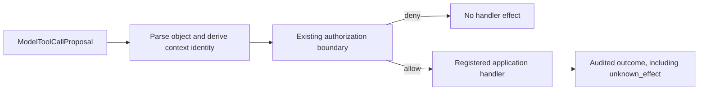

# T232 — Common authorized tool execution boundary

Status: Pending. This record documents an implementation slice only; it does
not establish independent acceptance, persistent grants, live execution,
deployment, VM validation or provider eligibility.

## Scope

The bounded `home.tool_boundary` registry/executor now accepts complete,
typed `ModelToolCallProposal` events through the existing
`InvocationContext`. The adapter parses only a JSON object, derives the role,
principal and correlation ID from the context, and delegates authorization to
the existing executor. Model output cannot provide a handler or bypass schema,
ownership, confirmation, guest denial or `unknown_effect` handling.

Persistent grants (T180), real tool handlers, provider calls, VM execution and
deployment are outside this slice.

## Behavior

Given a complete proposal and an authenticated user context, when the declared
tool and confirmation are valid, then the existing executor receives the
context-derived invocation and audits the outcome with the context request ID.

Given an incomplete, malformed, guest, cross-user or unconfirmed proposal,
when execution is requested, then it is denied before the handler is called.

## Validation and limits

- Tests use synthetic handlers and data only; no real tool is executed.
- Comparative and numeric benchmarks are waived by owner policy; functional,
  security, resource and recovery gates remain applicable.
- Independent fresh-context audit, full application validation as required by
  the test-scoping policy, and acceptance of T225/T226 remain open.

## Audit and uncertain-effect follow-up - 2026-11-14

The executor now calls its audit sink with a correlated `started` record before
invoking a handler and denies execution if that call fails. Unexpected
exceptions from write or external handlers produce `unknown_effect`; if the
outcome audit fails after such a call, `ToolAuditUncertain` carries the request
ID and signals an unknown effect. Read-handler exceptions remain ordinary
failures. The start and outcome records share the same request ID, including
when the executor generates it. Tool-proposal JSON is bounded before parsing
and rejects duplicate keys. Synthetic tests cover these paths and do not log
exception contents.

On Windows, `python manage.py test home.test_tool_boundary
home.test_grant_policy home.test_t237_consumers` passed 27 tests, and the full
`python manage.py test` suite passed 677 tests with 11 skipped. The same focused
27 tests passed on the running Debian ARM64 VM using a hash-verified temporary
source copy and isolated test database (archive SHA-256
`818edac413192e086dcbebb9717edc57171751acf01ee89d7be0c640d3393b87`). The
temporary copy was removed; no installed service or production database was
changed. These tests use synthetic audit sinks and handlers. They do not prove
that the audit sink is durable, provide a durable invocation ledger or replay
prevention, or connect actual handlers and the agent loop. T232 remains open.

## Durable consequential-call journal - 2026-11-14

Write and external declarations now require a per-call UUID and a journal
before execution. The database journal commits a minimal `started` record in
autocommit before the audit checkpoint and handler; it rejects calls inside an
outer transaction and denies duplicate IDs in every state. Proposal call IDs
derive a stable UUID from the invocation operation ID and call ID. Terminal
states record success, unknown effect, or confirmed non-dispatch; an
interrupted or uncommitted result remains `started` and cannot be replayed.
If a terminal journal update fails after a handler, the caller receives an
unknown-effect exception with the operation and request IDs. Normal ORM
deletion or reset of journal rows is denied. Records omit arguments and output.
User and admin tools also require an authenticated actor even when their
declaration has no ownership target.

On Windows, `python manage.py test home.test_tool_boundary
home.test_tool_journal home.test_grant_policy home.test_t237_consumers` passed
36 tests, including two concurrent SQLite connections claiming the same ID,
missing journal, transaction nesting, duplicate calls, audit failure and
terminal-write failure. The full `python manage.py test` suite passed 686 tests
with 11 skipped. A temporary SQLite database verified migration 0033 forward,
rollback refusal while a synthetic journal row exists, and reversal/reapply
after that temporary record was removed. The same 36 focused tests passed on
the existing Debian ARM64 VM using an isolated database and a hash-verified
temporary source copy (archive SHA-256
`5085206bf62c20ffa7c4c199b7864227b33da5444be8aba7feb0d3d91d9f94f3`). The
temporary copy was removed; no production service or database was changed.

T232 remains open: no production agent loop or actual tool handlers are wired
to this journal, audit sinks in these tests are synthetic, and crash recovery,
cross-process operation identity and real side effects require integrated
validation. A `started` or `unknown_effect` record is not evidence that a remote
effect stopped; no automatic replay is authorized.

## Proposal input hardening - 2026-11-15

The proposal adapter now fails closed for non-string or empty proposal IDs and
names before encoding, UUID derivation or registry lookup. Direct invocations
with a non-string tool name are also denied as `ToolDenied` rather than leaking
an internal mapping error. This keeps malformed model input inside the common
boundary and does not add handlers, persistent grants or external effects.

Focused validation: `python manage.py test home.test_tool_boundary
home.test_tool_journal --verbosity 1` passed 24 tests. `git diff --check`
passed. This remains synthetic local evidence only; T232 is still Pending.

## Denial audit hardening - 2026-11-15

Known-tool denials now emit a bounded `denied` outcome before returning
`ToolDenied`. This covers guest, cross-user, malformed/canonical-JSON,
confirmation, missing policy revision, and exact-grant denials. The denial
audit receives an invocation with an empty argument object and never a handler
result; audit failure remains fail-closed. Handlers are not called for these
cases. Focused validation (`home.test_tool_boundary`,
`home.test_tool_journal`, and `home.test_grant_policy`) passed 35 tests.
Malformed proposals that cannot be associated with a registered declaration
remain denied without a declaration-level audit record. This is synthetic
local evidence only and T232 remains Pending.

## Malformed known-proposal audit follow-up - 2026-11-23

Known-tool proposals rejected before JSON parsing completes (including
incomplete, invalid-JSON and duplicate-key proposals) now emit a correlated
`denied` outcome using the server-owned invocation request ID and an empty
argument object. The proposal's raw arguments and call ID are not copied into
the denial record. Unknown tool names still have no trusted declaration from
which to derive an audit event and remain denied without a declaration-level
record. Invalid invocation-context types are rejected before processing.

Validation on the local Windows checkout, using synthetic proposals and
handlers:

- `.venv\Scripts\python.exe manage.py test home.test_tool_boundary home.test_tool_journal home.test_grant_policy` — 36 tests passed.
- `.venv\Scripts\python.exe manage.py test` — 998 tests passed, 14 skipped.
- `.venv\Scripts\python.exe manage.py check` — passed.
- `.venv\Scripts\python.exe manage.py makemigrations --check --dry-run` — no changes detected.
- `git diff --check` — passed; Git reported its existing LF-to-CRLF worktree-normalization notices.

No live tool handler, provider, production database, VM service, deployment or
real side effect was used. T232 remains Pending: this does not wire the
executor into a production agent loop or establish durable integration for
real handlers, crash recovery or cross-process operation identity.

## Agent-loop integration review - 2026-11-23

The current `ModelToolCallProposal` event is validated by the model interface
and can be passed directly to `AuthorizedToolExecutor.execute_proposal`, but no
product runtime does so. `FreeModelRouter` yields validated model events;
`run_gemini_turn` uses the existing text response path and has no proposal
consumer, application-owned tool declarations or real tool handlers.

Connecting model proposals to that runtime would enable model-directed user
actions. The accepted product requirements already define the initial
main-agent tool, `recall_memory` (Q-64/P-54): it is restricted to the
authorized main agent, calls the same non-reasoning memory agent, and cannot
recurse or run for guests. This is an accepted feature direction, not proof
that its dependencies or runtime integration are complete. The existing grant
contract remains limited to reviewed non-consequential reads; consequential
actions need individual confirmation and the durable journal. No general
action-tool set is authorized by the `recall_memory` requirement.

No runtime code was changed in this review. T232 remains Pending. The minimal
product path is to finish T184's server-bound retrieval authorization and
T185's bounded recall callback, then register only `recall_memory` for an
authorized main-agent context. T230 already supplies its budget lifecycle.
The missing engineering contract is a production model loop that can request
tool proposals, preserve call/result correlation, and return tool results as
untrusted content; current chat dispatch and adapters do not provide that
path. Implement and test that protocol without enabling other tools or guests.
