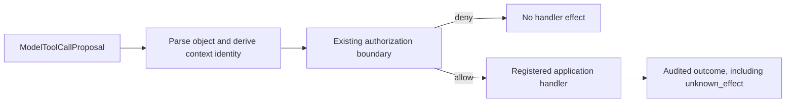

# T232 — Common authorized tool execution boundary

Status: Pending. This record documents an implementation slice only; it does
not establish independent acceptance, persistent grants, live execution,
deployment, VM validation or provider eligibility.

## Scope

The bounded `home.tool_boundary` registry/executor now accepts complete,
typed `ModelToolCallProposal` events through the existing
`InvocationContext`. The adapter parses only a JSON object, derives the role,
principal and correlation ID from the context, and delegates authorization to
the existing executor. Model output cannot provide a handler or bypass schema,
ownership, confirmation, guest denial or `unknown_effect` handling.

Persistent grants (T180), real tool handlers, provider calls, VM execution and
deployment are outside this slice.

## Behavior

Given a complete proposal and an authenticated user context, when the declared
tool and confirmation are valid, then the existing executor receives the
context-derived invocation and audits the outcome with the context request ID.

Given an incomplete, malformed, guest, cross-user or unconfirmed proposal,
when execution is requested, then it is denied before the handler is called.

## Validation and limits

- Tests use synthetic handlers and data only; no real tool is executed.
- Comparative and numeric benchmarks are waived by owner policy; functional,
  security, resource and recovery gates remain applicable.
- Independent fresh-context audit, full application validation as required by
  the test-scoping policy, and acceptance of T225/T226 remain open.
