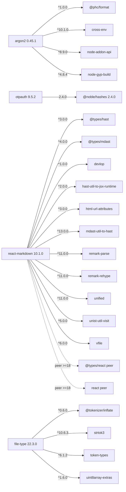

# T014 partial dependency graph

Status: research evidence only, 2026-10-31. This graph is assembled from retained records; it is not a resolver result, lockfile, approved manifest, or package recommendation. No dependency was selected, installed, resolved, or executed.

## Exact npm artifact edges

The graph below records dependency and peer ranges from the exact npm package metadata inspected in [the artifact review](evidence/t014-authorized-npm-artifact-review.json). These four packages were authorized for research only. `@noble/hashes` is included because it is the recorded exact direct dependency of `otpauth`.

This shows 20 declared dependency edges and two peer requirements, not their resolved versions. The peer nodes are requirements, not assertions that a compatible React or type package has been selected. Transitive, optional, platform-specific and build-tool closures for these edges remain unenumerated.

## QEMU host package metadata traversal

The retained [QEMU inventory](evidence/t014-msys2/qemu-inventory.json) contains 159 package records and 502 dependency edges from an exploratory traversal rooted at `mingw-w64-ucrt-x86_64-qemu`. Its source database digest is `3253eb5ed9d16e936b4ca854d2ca2eb5c3d164322967f0dad21cf26eca484248`; [the inventory script](evidence/t014-msys2/build_inventory.py) records how edges were derived. The traversal matched 495 requirements by exact package name and seven through a unique declared `PROVIDES` name; four constrained edges received static version checks.

These are repository-metadata relationships, not a pacman transaction or solver-equivalent closure. Optional dependencies are recorded but are not traversed as required edges. The inventory does not establish trusted provenance, current advisory coverage, license dispositions, actual VM devices, or approval of any package.

## Boundary and next action

This is the graph available from existing retained evidence, not the complete T042/T014 dependency graph. Other candidate versions in the [T042 scope inventory](t014-t042-scope.md) do not have an artifact-backed dependency closure here. The owner declined expanding research to additional unresolved roles; this graph does not fill or waive those roles, change T042's hard prerequisites, or authorize a resolver. Keep the missing edges explicit and defer separately scoped issues to new tasks as they arise. T014 remains blocked until its required graph, checks, compatibility evidence and approvals are complete.
